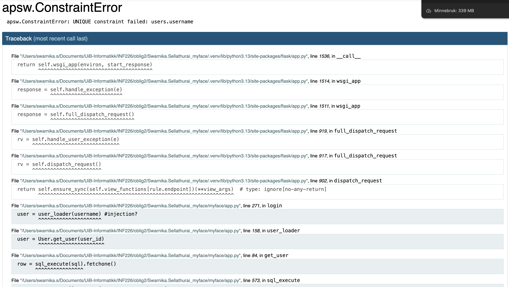
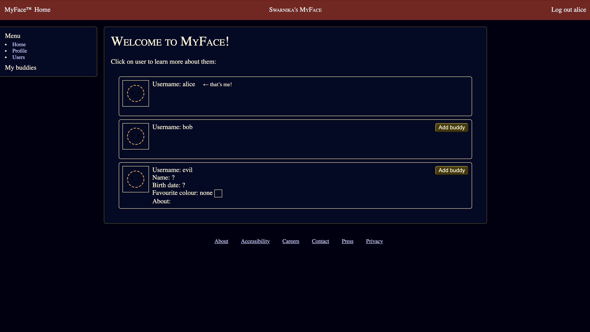
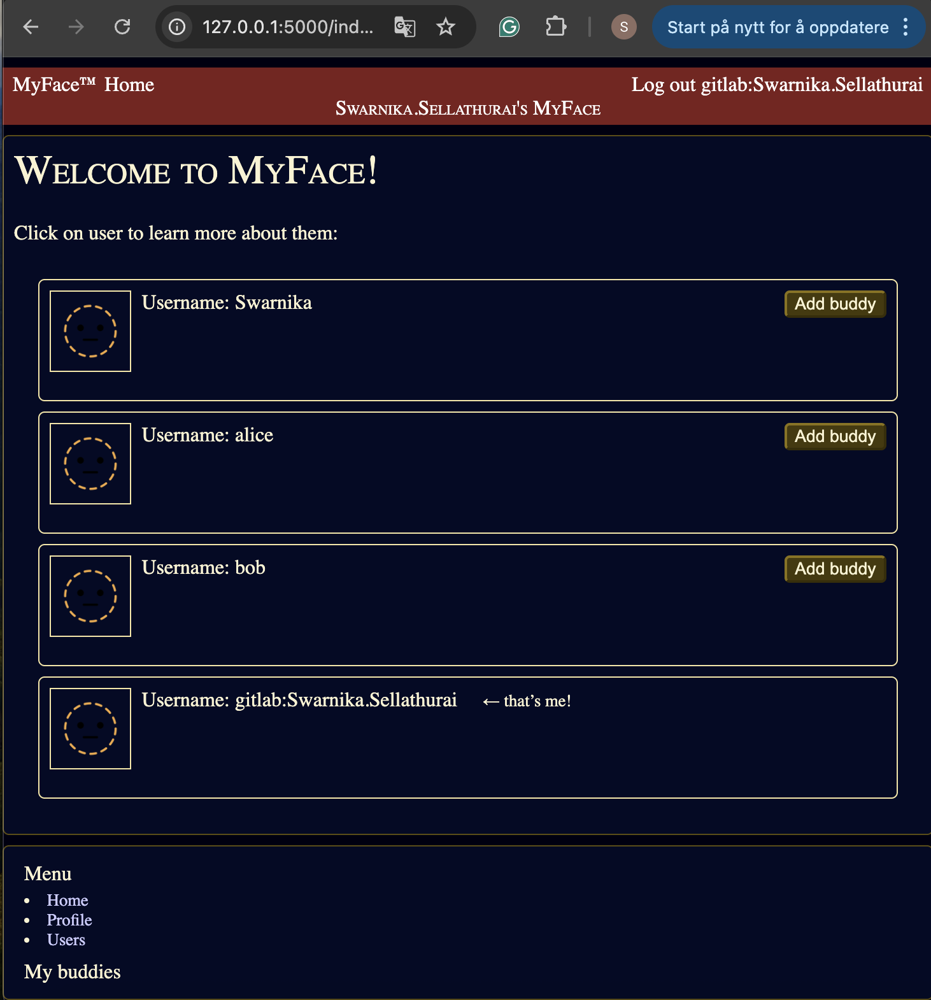

# MyFace Report for _NAME_

## Tasks

### a) SQL Injection

> How did you do the SQL injection and what did you do to fix it?
> I firstly looked at the original code, the User.save() and the methods in User.get_user.The methods were built in SQL like this:
> f"SELECT id, username, password, info FROM users WHERE username = '{userid}';"
> , so the application was doing f-strings directly into SQL, which means the things that are typed in user is in a form, it gets placed inside the SQL statement without being parametrized. This is a very typical condition for SQL injection.

So, this means that fro the user input, since it was placed inside single quotes i realized i could try to close that string and add a second SQL statement, so i sent in this:
"INSERT INTO users (username, password, info) VALUES ('evil', 'pw123', '{}'); --"

and by doing that and logging in I came to this page:

here i have injected my own statement and added -- at the end to comment out the rest, so that ' from the original query would be ignored.

Then by logging in as Alice now i saw that a new user was made:

the only reason this was possible is because the SQL was built with f-strings, so to fix the weakness I had to debug the code and saw that several queries where made with the f-string so I removed it and changed the SQL calls so they no longer change user input into SQL strings, instead uses parameterized queries everywhere user data is used.
this was for example one querie first: sql_execute(
f"UPDATE users SET username='{self.username}', password='{self.password}', info='{info}' WHERE id={self.id};"
), this was after: sql_execute(
"UPDATE users SET username = ?, password = ?, info = ? WHERE id = ?;",
(self.username, self.password, info, self.id),
). So now the database treats the user input only as data, I also changed the logic codde to check password hashes so when someone maybe got a row back by injection, they wouldnt just be able to log in with plain text. So when i now tried to make anew user again i gto this error message:

### b) JS Code Injection

> How did you inject JS code?
> I injected it by editing my profile´s About field and inserted HTML/JS and wrote: . The homepage fetches users as JSON from /users/ and scrips.js rendered those values with innerHTML/string interpolation. Because my input was inserted as HTML and not plaintext the browser took the tag and execute the event handler, XXS,
>  > 
>
> Could we solve it with CSP?
> Partly with a strict CSP could stop many payloads like inline event handlers and < script > tags. But is it a safety net, so it doesnt fix the root cause which is that the user input can go into innerHTML.
>
> Does it work on `/users/me`? Why not?
> No, users/me returns a server-side rendereed Jinja2 template. JInja escapes specials characters, so my  shows as text and no script runs. The vulnerability was in the client-side rendering and not the server template.
>
> How did you fix the problem?
> I removed innherHTML and switched to safe client-side templating (qhthml, microhtml) that inserts data as text and sets attributes explicitly. So rewrote the format_field function to return a qhtml templtae instead of an HTML string, changed format_profile to call render(elt, html) instead of eøt.innerHTML and added isSafeUrl to validate the href. qhtml build a rel DOM nodes and esacpes inserted values by default, so the user concntent is treated as data. so now it is safer,
> 

### c) Access Control

> What do you think about how passwords are currently stored?
> ouffff this task took so long to finish bahaha, so now I am finally ready to write the report. I think the passwords were stored suspiciously, there was a risk that plaintext password could be written to the DB if hashing wasnt enforced at every save, and iits was also possible to accept weak or even empty passwords during profile updates.

> How did you improve it?
> I improves it by ensuring safe storage with hash + salt in def eensure_hashed.... and called it inside User.save() so that it was guranteed taht every raw password was stored as a salted PBKDF2 hash and not plaintext.
> I stength chcked it also by added a clear policy and enforced it on password change in profile.This make it so it is required to atleast have 8 charachter, one lowercase, one uppercase and one digit. This prevents empty or trivially weak passwords.
> I also removeed also duplicate block of if form.password.data and instead kept one block that calls require_strong:password then the other hashes it. So now the the password is more protected against rainbow tables and increases brute force cost. Enforcing strong password rules reduces the chance of easy compromises :D.

> Explain your access control scheme
> So the goal was that users cant see the full profile of everyone, the information should only be viewable for yourself and the people you have granted your access to, like friends/buddies. so i used buddies (user1_id, user2_id) as a one-way grant, so when user1 has added user2, the user2 can view user1's info but user1 can not view user2's info before they accept the request. Mutual buddies means that both directions work. i did this by firstly cheching one way grant, then making a can_view_full_profile, santizing before returning function then applied it in routes. I also added in script.js emojies and a sidenote if both sides added each other or someone has granted access to you.

> Did you add buddies?
> Yes
> 
> then here we see (i made a new user too named after myself), that when alice is not friends with someone she cant see their info:
> 
> but after she has added another user, the other user can se their info, and the add back:
> 
> now when i log in as alice again since swarnika has accepted she can see swarnika's info too:
> 

> Can a user change another users profile info?
> no, only the current user can change it as written in @login required, where it always writes that current_user can change.

### d) Security Analysis

> Which project did you review? (Full URL to repository)
> My own, https://git.app.uib.no/inf226/25h/proj/Swarnika.Sellathurai_myface

> Write you analysis in the [Security Analysis](#security-analysis) section below.

### e) OpenId Connect

> Did you implement OIDC?
> Yes. the Login with GitLab (git.app.uib.no) is implemented using the authorization code flow with Authlib, integrated also with Flask-Login on the already existing SQLite user store.
> How did you do it?
> I added authlib and initialized OAuth(app), registered a provider names gitlab using GitLabs discovery docuemnt. then i created a secrets_debug.cfg there the file is loaded by load_or_generate_secrets(app) and app.config.from_prefixed_env("MYFACE") so the env vars can override if needed. I also configuered the GitLab OAuth application with redirect URI http://127.0.0.1:5000/login/callback.

-   the GET in login in gitlab starts the OIDC flow and saves a safe next URL in session and calls: redirect_uri = url_for("login_callback", external=True)
    return app.oauth.gitlab.authorize_redirect(redirect_uri)
    the the Authlib handles state/nonce for CSRF protection. the callback exchanges also code for tokens and fetches userinfo, from the userinfo it read sub, preferred_username, name, picture, email. then it upserts a local user in SQLite via aps, then logs in the user using Flask-login and redirects it back.
    -Users live in the SQLite database, on the first run ot creates the scheme ans seed sample users, then after the OIDC login it updates to the local user, then relies on the Flask session cookie signes by SECRET:KEY, plus Flask-Login for subsequent requests.

> Does it work? (it might be difficult for the TAs to test this on their own computers)
> yes it works. I get the GitLab consent screen, authorize, and i am redirected back to /login/callback. The logs show the code exchange successfully and redriects to /index.html. In the phot below it shows me logges in as swarnika.sellathurai and users lists.
> 

## z) Improvements (bonus)

> Did you make any improvements after the main deadline? Make a list of exactly what changes you made.

## å) Chat log (bonus)

> Include your AI chat log in [`AI_LOG.txt`](./AI_LOG.txt)

## MyFace Security Analysis

The goal of the app MyFace is to let users log in, edit a profile, and see other users wiith a "buddy" access model. Backend is Flask + SQLite; frontend uses pthml templates with a small script.js. This review covers the server (app.py) and how it interacts with the client

analysis of app.py:
Threat model
actors

-   external attackers (unauthenticated) trying to abuse enpoints (login brute force, CSRF)
-   malicious users (authenticated) trying to view/modify other user's private data
-   curious insiders (access to logs/config) trying to escalate privileges

assets

-   credentials (password hashes, tokens)
    -profile data (name, birthdate, picture URL, about, color)
-   sessional data (cookies, SECRET_KEY)

Primary risks

-   CSRF on mutating endpoints
-   weak session/ secret handling
-   insecure password storage or validation
-   input validation gaps leading to XXS or URL-based abuse
-   information leakage through logs.

Vulnerabilities I considered

-   Password strength & storage policy unclear or weak
-   session cookie flags and SECRET_KEY not enforced for production
-   CSRF exposure on /profile and /buddies/\*
-   unvalidated profile fields (picture_url, color, about) -> stored XXS / abuse
-   authentication header handling: Basic allowed; credentials/tokens logges; Bearer not implemented
-   potential API bypass of access control if /users/<id> returned full objects

Fixes that i Implemented:
Password policy & hashing

-   PBKDF" hashinh via Werkzeug; require_strong_password() (>= 8 chars, upper/lower/digit) enforced on password change.
-   new helpers for serve side input validation, only absolute http(s) picture_url; hex colors (#RGB/ #RRGGBB); max length for about and validation called in profile() before save()
-   SESSION_COOKIE_HTTPONLY =True, SAMESITE= 'Lax', SECURE=not app.debug, custom cookie name.
-   SECRET_KEY required from environment in prod (no weak fallback)
-   made Lightweight CSRF guard, before_request same-origin check for unsafe methods (POST/PUT/PATCH/DELETE) blocks cross-site actions
-   hardend the authencations loader by disabling Basic auth in production and stop logging credentials / tokens, implemented Bearer by validating tokens via User.get_token_user().
-   enforced access control in API, /user/ <id> returns sanitized profile using sanitize_user_for_view(), full fields only for selv or if target granted buddy access.

Script.js:
Risks I saw:

-   Attribute injection / XXS: unvalidated user.color was concatenated into a style attribute, which can have malicious values and could have executed in some browsers.
-   CSRF/ session issues in fetch: the app relied on default fetch credentials where some browsers may omit cookies, unless explicitly set
-   double-submit / race conditions: rapid clicks on "Add buddy" could trigger multiple POSTs

so the fixes i did:

The url and color validation:

-   the isSafeUrl(url) allows only absolute http(s) URLs
-   safeColor(c) only allows #RGB or #RRGGBB
-   style attribute is now built from a fully validated value: style =${\ background: $(c)`}`.

safer networking:

-   fetch_json sets credentials: 'same-origin' to ensure session cookies are sent only to your own origin
-   hardend the content-type checks and try/catch with user feedback
    UX and more integrity:
-   disable the "Add buddy" button during the request to prevent duplicate submissions
-   coerce userID to Number before building URLs (avoids accidental string pollution)

privacy hardening:

-   referrerpolicy= "no-referrer" on user images to avoid leaking page URLs to third-party CDNs

login.html:

-   i changed action="/login/" to action="{{ url_for('login') }}" because it was safer, it avoids broken links and misroutes if paths change and prevents mistaked that could send credentials to the wrong endpoints.
-   kept CSRF only where it matters, password form. now it protects the credential-submitting Post without adding meaningless tokens to GET redirect.
    …
